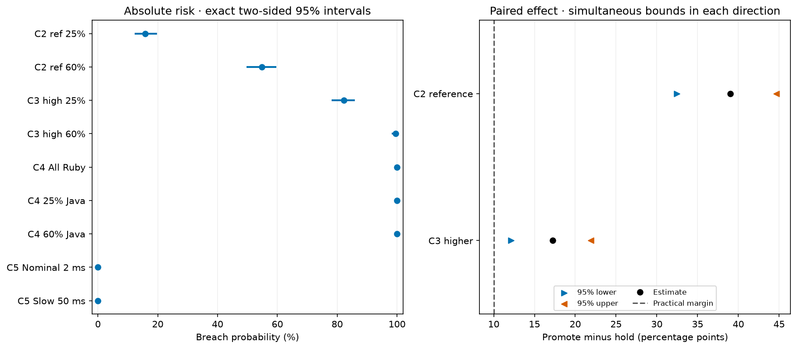
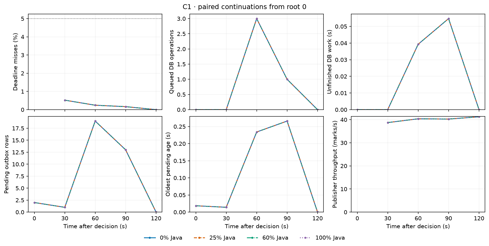
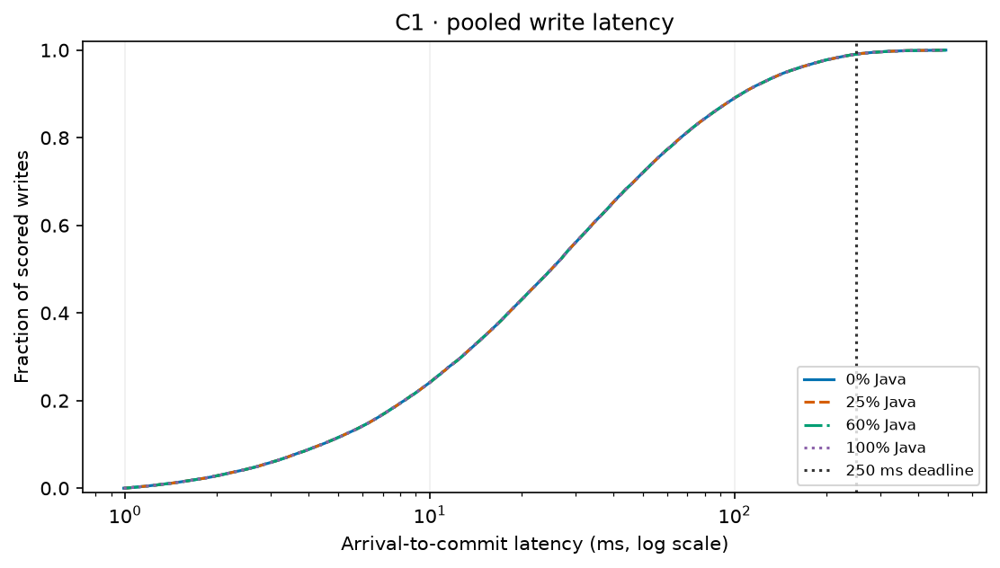
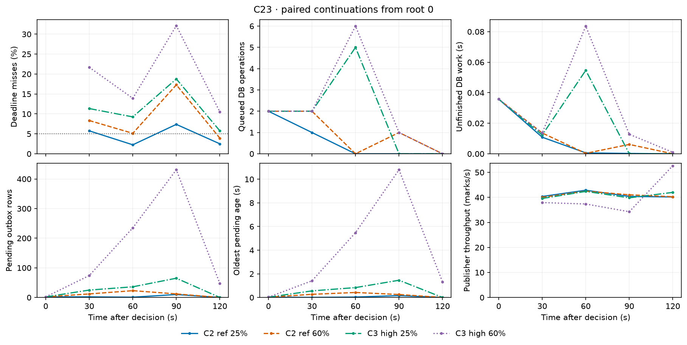
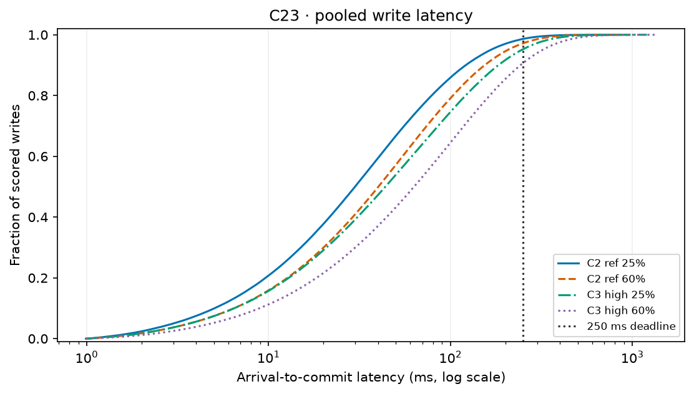
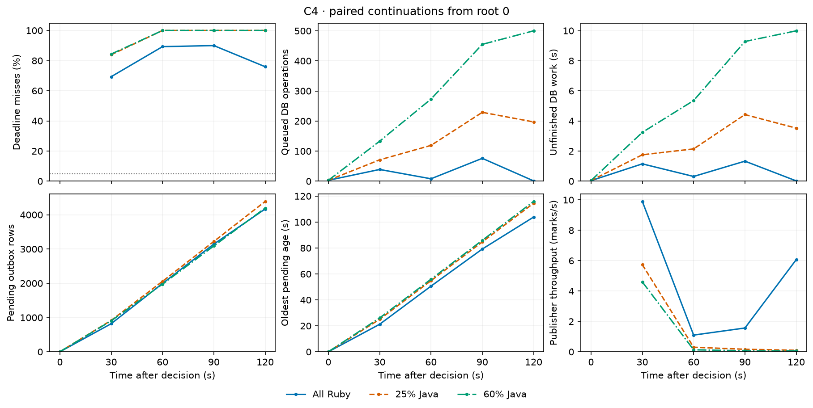
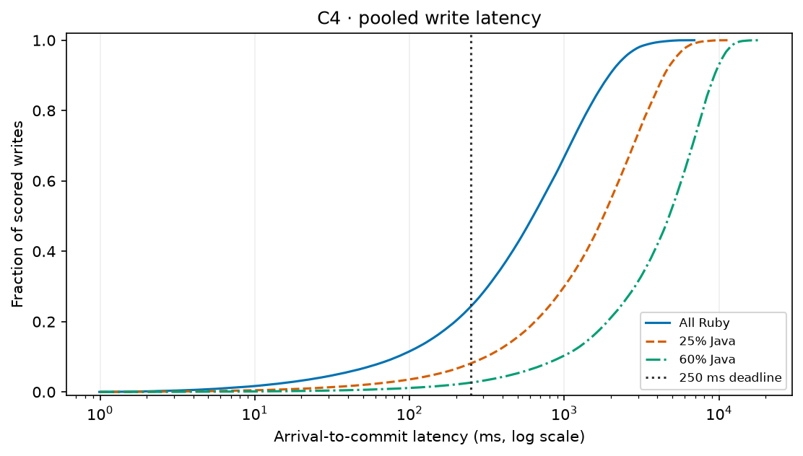
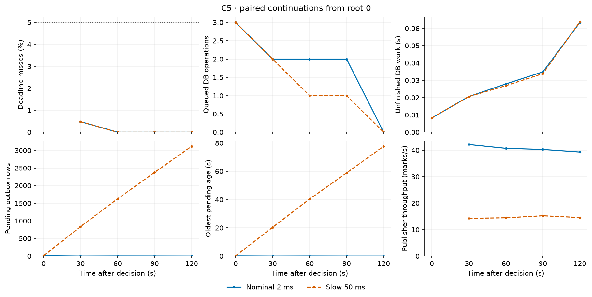
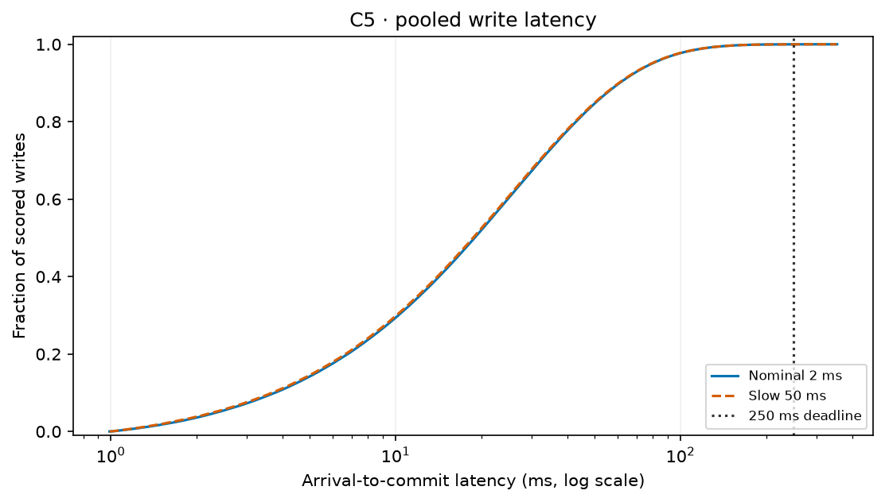

# AIMS5701 feasibility pilot

**Overall verdict — GO.** Migration evidence relative to the 10-point margin: consequential. C5 write health: demonstrated. C5 outbox age criterion passed.

**C2/C3 migration mechanism.** A consequential migration effect was demonstrated in at least one predeclared setting. The comparison holds at 25% Java or promotes to 60% under the same simulated inputs.

**C5 publisher-specific ambiguity.** Write health was demonstrated. Meaningful outbox deterioration was demonstrated. This control requires evidence for both conditions.

Each breach is one 120 s history with more than 5% late writes in any 30 s window. Deadlines are 250 ms from arrival. Absolute risks use independent histories as denominators. The historical four-nines availability target motivated the study. These results concern a synthetic latency endpoint.

One non-preemptive FIFO DB serves both routes, background queries and the common outbox publisher. At 40 writes/s the migration condition assigns a mean of 12 ms of synchronous DB work to a Ruby write and 16 ms to a Java write, including the same atomic insert. Promotion therefore adds 5.6 percentage points of offered DB load at either background setting. These service costs represent a synthetic implementation difference.

| Control | Finding |
| --- | --- |
| C1 equal work | 16 of 16 root histories passed the four-share trace comparison. |
| C2 reference demand | Promotion changed breach risk by +39.00 pp. |
| C3 higher demand | Promotion changed breach risk by +17.25 pp. The high-minus-reference interaction was -21.75 pp. |
| C4 background overload | All-Ruby absolute risk was 100.00%. The paired promotion effect was +0.00 pp. |
| C5 slow publisher | Sensor ambiguity demonstrated. |

## C0 queue validation and C1 placebo

The isolated queue uses the simulator's FIFO service path. Each cell compares the 95% Student-t interval across independent seed means with its analytical equivalence band.

| Queue | Arrivals/s | Seeds | Expected wait (ms) | Observed (ms) | 95% interval (ms) | ±10% band (ms) | Status |
| --- | --- | --- | --- | --- | --- | --- | --- |
| M/M/1 | 50 | 32 | 10.00 | 10.00 | 9.89 to 10.10 | 9.00 to 11.00 | pass |
| M/M/1 | 90 | 32 | 90.00 | 91.74 | 88.81 to 94.66 | 81.00 to 99.00 | pass |
| M/D/1 | 50 | 32 | 5.00 | 4.97 | 4.94 to 5.00 | 4.50 to 5.50 | pass |
| M/D/1 | 90 | 32 | 45.00 | 44.98 | 43.88 to 46.08 | 40.50 to 49.50 | pass |

C1 matches the per-request service draw and publisher lifecycle across 0%, 25%, 60% and 100% Java. Its exact path check excludes the routing label and includes physical times and states.

## C2/C3 routing effect

| Setting | Paired roots | Neither | Hold only | Promote only | Both | Δ risk (pp) | Lower (pp) | Upper (pp) |
| --- | --- | --- | --- | --- | --- | --- | --- | --- |
| C2 reference | 400 | 181 | 0 | 156 | 63 | +39.00 | +32.44 | +44.67 |
| C3 higher | 400 | 2 | 0 | 69 | 329 | +17.25 | +12.12 | +21.91 |

The paired estimate subtracts hold-only from promote-only counts and divides by all roots. Each column of directional bounds has simultaneous one-sided 95% coverage across both settings. A lower bound reaching +10 pp qualifies a setting. Exclusion requires both upper bounds strictly below +10 pp.

At the observed hold risks, the largest possible *sample* increase was 84.25 pp under reference demand and 17.75 pp under higher demand. This ceiling helps interpret saturation. The frozen bounds determine the migration finding.

**Background interaction.** High minus reference was -21.75 pp (descriptive 95% whole-root bootstrap interval -28.50 to -15.00 pp). Higher background demand reduced the measured promotion effect on this endpoint. All four branches shared one 60 s prefix. The extra queries began at the cut, so pre-decision telemetry carried no warning of their arrival.

## C5 publisher-only intervention

The two branches share 25% Java, 40 writes/s, an initial nominal publisher and zero background arrivals. New acknowledgement waits last 2 or 50 ms. DB work remains 1 ms per claim and per mark.

| Write-health quantity | One-sided 95% upper bound | Required |
| --- | --- | --- |
| nominal | 0.75% | < 5.00% |
| slow | 0.75% | < 5.00% |
| Slow minus nominal | +0.92 pp | < +2.00 pp |

The paired risk difference was +0.00 pp. Of 400 pairs, 0 breached only under slow acknowledgement, 0 only under nominal, 0 under both and 400 under neither. The corresponding one-sided lower bound on harm was -0.92 pp. Write health was demonstrated.

**Oldest pending age.** In 400 of 400 paired histories (100.00%), the slow branch's oldest pending row was at least 5 s older at the horizon. The exact one-sided 95% lower bound was 99.25%. The required bound is strictly above 50.00%. Empty outboxes contribute zero seconds. Claimed rows remain pending until their marks complete.

## Absolute breach risks

| Branch | Breached | Histories | Risk | 95% exact interval |
| --- | --- | --- | --- | --- |
| C2 ref 25% | 63 | 400 | 15.75% | 12.32% to 19.70% |
| C2 ref 60% | 219 | 400 | 54.75% | 49.73% to 59.70% |
| C3 high 25% | 329 | 400 | 82.25% | 78.15% to 85.87% |
| C3 high 60% | 398 | 400 | 99.50% | 98.21% to 99.94% |
| C4 All Ruby | 400 | 400 | 100.00% | 99.08% to 100.00% |
| C4 25% Java | 400 | 400 | 100.00% | 99.08% to 100.00% |
| C4 60% Java | 400 | 400 | 100.00% | 99.08% to 100.00% |
| C5 Nominal 2 ms | 0 | 400 | 0.00% | 0.00% to 0.92% |
| C5 Slow 50 ms | 0 | 400 | 0.00% | 0.00% to 0.92% |

## C4 background overload

Under overload the all-Ruby risk was 100.00%, compared with 100.00% at 25% and 100.00% at 60%. The paired promote-minus-hold increment was +0.00 pp (descriptive 95% bootstrap interval +0.00 to +0.00 pp). The all-Ruby baseline warmed up at 0% Java. The other two branches shared a 25% warm-up. Both branches breached in every sampled horizon. The binary endpoint saturated. All paired differences were zero, so every empirical bootstrap resample returned zero. This degenerate interval leaves the magnitude of additional waiting to the latency diagnostics.

## Application writes and database demand

The expected and realised demand columns count total work owed by the arrival cohort relative to capacity. DB utilisation counts in-window occupied time, including partial visits. Miss fractions pool eligible writes. A busy server can accumulate additional work while utilisation stays close to 100%.

| Branch | Expected demand | Realised demand | DB utilisation | Misses | Eligible writes | Miss fraction |
| --- | --- | --- | --- | --- | --- | --- |
| C1 0% Java | 70.00% | 70.79% | 70.76% | 726 | 76993 | 0.94% |
| C1 25% Java | 70.00% | 70.79% | 70.76% | 726 | 76993 | 0.94% |
| C1 60% Java | 70.00% | 70.79% | 70.76% | 726 | 76993 | 0.94% |
| C1 100% Java | 70.00% | 70.79% | 70.76% | 726 | 76993 | 0.94% |
| C2 ref 25% | 74.00% | 74.00% | 74.00% | 26409 | 1914342 | 1.38% |
| C2 ref 60% | 79.60% | 79.61% | 79.59% | 54178 | 1914342 | 2.83% |
| C3 high 25% | 82.00% | 82.04% | 82.00% | 91734 | 1914342 | 4.79% |
| C3 high 60% | 87.60% | 87.65% | 87.52% | 179046 | 1914342 | 9.35% |
| C4 All Ruby | 106.00% | 105.96% | 98.74% | 1448739 | 1915815 | 75.62% |
| C4 25% Java | 110.00% | 109.97% | 99.60% | 1759870 | 1915815 | 91.86% |
| C4 60% Java | 115.60% | 115.57% | 99.86% | 1864927 | 1915815 | 97.34% |
| C5 Nominal 2 ms | 60.00% | 60.01% | 60.00% | 163 | 1916874 | 0.01% |
| C5 Slow 50 ms | 60.00% | 60.01% | 54.96% | 154 | 1916874 | 0.01% |

### Write latency

Empirical percentiles use the same deadline-based cohort as the breach score. The pooled row weights writes equally across both routes. Outstanding writes can complete during the closed-arrival diagnostic drain. A lower-bound symbol identifies an indeterminate percentile due to right censoring. Dashes denote empty cohorts.

| Branch | Route | Writes | Censored | p50 ms | p95 ms | p99 ms |
| --- | --- | --- | --- | --- | --- | --- |
| C1 0% Java | pooled | 76993 | 0 | 25.03 | 148.19 | 245.96 |
| C1 0% Java | Ruby | 76993 | 0 | 25.03 | 148.19 | 245.96 |
| C1 0% Java | Java | 0 | 0 | — | — | — |
| C1 25% Java | pooled | 76993 | 0 | 25.03 | 148.19 | 245.96 |
| C1 25% Java | Ruby | 57907 | 0 | 24.91 | 147.51 | 246.82 |
| C1 25% Java | Java | 19086 | 0 | 25.55 | 150.63 | 243.64 |
| C1 60% Java | pooled | 76993 | 0 | 25.03 | 148.19 | 245.96 |
| C1 60% Java | Ruby | 31043 | 0 | 24.84 | 147.09 | 248.11 |
| C1 60% Java | Java | 45950 | 0 | 25.16 | 148.95 | 244.60 |
| C1 100% Java | pooled | 76993 | 0 | 25.03 | 148.19 | 245.96 |
| C1 100% Java | Ruby | 0 | 0 | — | — | — |
| C1 100% Java | Java | 76993 | 0 | 25.03 | 148.19 | 245.96 |
| C2 ref 25% | pooled | 1914342 | 0 | 29.86 | 166.13 | 270.66 |
| C2 ref 25% | Ruby | 1435645 | 0 | 28.65 | 164.91 | 269.01 |
| C2 ref 25% | Java | 478697 | 0 | 33.53 | 169.65 | 275.26 |
| C2 ref 60% | pooled | 1914342 | 0 | 40.17 | 206.35 | 328.26 |
| C2 ref 60% | Ruby | 764989 | 0 | 37.11 | 203.61 | 325.17 |
| C2 ref 60% | Java | 1149353 | 0 | 42.19 | 208.05 | 330.47 |
| C3 high 25% | pooled | 1914342 | 0 | 43.85 | 246.05 | 388.50 |
| C3 high 25% | Ruby | 1435645 | 0 | 42.55 | 244.68 | 386.25 |
| C3 high 25% | Java | 478697 | 0 | 47.60 | 250.12 | 394.72 |
| C3 high 60% | pooled | 1914342 | 0 | 63.08 | 319.90 | 498.82 |
| C3 high 60% | Ruby | 764989 | 0 | 60.14 | 317.10 | 494.96 |
| C3 high 60% | Java | 1149353 | 0 | 65.00 | 321.86 | 501.36 |
| C4 All Ruby | pooled | 1915815 | 0 | 629.21 | 2,432.80 | 3,562.29 |
| C4 All Ruby | Ruby | 1915815 | 0 | 629.21 | 2,432.80 | 3,562.29 |
| C4 All Ruby | Java | 0 | 0 | — | — | — |
| C4 25% Java | pooled | 1915815 | 0 | 1,794.40 | 5,229.42 | 6,783.18 |
| C4 25% Java | Ruby | 1436609 | 0 | 1,791.51 | 5,223.56 | 6,777.28 |
| C4 25% Java | Java | 479206 | 0 | 1,802.64 | 5,247.41 | 6,801.05 |
| C4 60% Java | pooled | 1915815 | 0 | 4,760.56 | 10,522.62 | 12,531.98 |
| C4 60% Java | Ruby | 765672 | 0 | 4,759.22 | 10,512.69 | 12,529.66 |
| C4 60% Java | Java | 1150143 | 0 | 4,761.37 | 10,528.46 | 12,533.37 |
| C5 Nominal 2 ms | pooled | 1916874 | 0 | 18.93 | 79.32 | 121.87 |
| C5 Nominal 2 ms | Ruby | 1437841 | 0 | 17.98 | 77.31 | 119.67 |
| C5 Nominal 2 ms | Java | 479033 | 0 | 22.02 | 84.45 | 127.38 |
| C5 Slow 50 ms | pooled | 1916874 | 0 | 18.69 | 78.87 | 121.34 |
| C5 Slow 50 ms | Ruby | 1437841 | 0 | 17.75 | 76.85 | 119.10 |
| C5 Slow 50 ms | Java | 479033 | 0 | 21.77 | 84.02 | 127.04 |

### DB queue growth

Values are per-root means at the decision and horizon. Unfinished work includes the active visit's residual and queued visits. Future publisher visits owed by pending rows appear in cohort demand and are tracked in the outbox.

| Branch | Queued at cut | Queued at 120 s | Change | Work at cut (s) | Work at 120 s (s) | Change (s) |
| --- | --- | --- | --- | --- | --- | --- |
| C1 0% Java | 1.44 | 3.69 | 2.25 | 0.017 | 0.047 | 0.029 |
| C1 25% Java | 1.44 | 3.69 | 2.25 | 0.017 | 0.047 | 0.029 |
| C1 60% Java | 1.44 | 3.69 | 2.25 | 0.017 | 0.047 | 0.029 |
| C1 100% Java | 1.44 | 3.69 | 2.25 | 0.017 | 0.047 | 0.029 |
| C2 ref 25% | 2.31 | 2.27 | -0.05 | 0.041 | 0.039 | -0.002 |
| C2 ref 60% | 2.31 | 2.85 | 0.53 | 0.041 | 0.051 | 0.010 |
| C3 high 25% | 2.31 | 3.55 | 1.24 | 0.041 | 0.063 | 0.022 |
| C3 high 60% | 2.31 | 4.80 | 2.49 | 0.041 | 0.089 | 0.048 |
| C4 All Ruby | 1.77 | 54.27 | 52.51 | 0.033 | 1.026 | 0.993 |
| C4 25% Java | 2.15 | 177.95 | 175.80 | 0.040 | 3.475 | 3.435 |
| C4 60% Java | 2.15 | 461.13 | 458.98 | 0.040 | 9.478 | 9.437 |
| C5 Nominal 2 ms | 0.90 | 0.96 | 0.06 | 0.014 | 0.014 | 0.000 |
| C5 Slow 50 ms | 0.90 | 0.85 | -0.05 | 0.014 | 0.014 | 0.000 |

### Outbox and publisher

Counts and oldest age are mean snapshots. Throughput is completed marks per horizon second. Delay columns average per-window percentiles across windows with marks. The no-mark count preserves windows with no observed delay.

| Branch | Pending at cut | Pending at 120 s | Oldest at 120 s (s) | Throughput (marks/s) | Mean window p50 delay (s) | Mean window p95 delay (s) | No-mark windows |
| --- | --- | --- | --- | --- | --- | --- | --- |
| C1 0% Java | 3.81 | 9.12 | 0.199 | 40.14 | 0.052 | 0.582 | 0 |
| C1 25% Java | 3.81 | 9.12 | 0.199 | 40.14 | 0.052 | 0.582 | 0 |
| C1 60% Java | 3.81 | 9.12 | 0.199 | 40.14 | 0.052 | 0.582 | 0 |
| C1 100% Java | 3.81 | 9.12 | 0.199 | 40.14 | 0.052 | 0.582 | 0 |
| C2 ref 25% | 7.35 | 7.54 | 0.154 | 39.96 | 0.078 | 0.776 | 0 |
| C2 ref 60% | 7.35 | 14.70 | 0.318 | 39.90 | 0.178 | 1.308 | 0 |
| C3 high 25% | 7.35 | 21.56 | 0.488 | 39.84 | 0.289 | 1.757 | 0 |
| C3 high 60% | 7.35 | 60.52 | 1.451 | 39.51 | 1.152 | 3.489 | 0 |
| C4 All Ruby | 4.88 | 3,806.56 | 95.586 | 7.98 | 45.392 | 53.648 | 0 |
| C4 25% Java | 6.86 | 4,377.81 | 112.397 | 2.46 | 51.816 | 62.665 | 0 |
| C4 60% Java | 6.86 | 4,367.31 | 117.641 | 0.75 | 54.198 | 64.099 | 0 |
| C5 Nominal 2 ms | 1.92 | 2.11 | 0.032 | 40.01 | 0.023 | 0.210 | 0 |
| C5 Slow 50 ms | 1.92 | 3,032.09 | 75.716 | 14.77 | 37.905 | 46.382 | 0 |

### DB visits and waiting by workload

Completed visits and busy seconds are means per 120 s horizon. Mean wait pools visits that entered service. The final column counts visits still queued at the horizon, averaged over roots. Expected demand charges eventual publication to each write. Admitted demand charges actual claim and mark visits when they reach the DB.

| Branch | Workload | Expected demand | Admitted demand | Completed visits | Busy (s) | Observed mean wait (ms) | Still queued at 120 s |
| --- | --- | --- | --- | --- | --- | --- | --- |
| C1 0% Java | write | 48.00% | 48.36% | 4,821.69 | 58.011 | 31.11 | 2.94 |
| C1 0% Java | query | 14.00% | 14.39% | 425.44 | 17.262 | 30.63 | 0.12 |
| C1 0% Java | claim | 4.00% | 4.01% | 4,816.69 | 4.817 | 6.03 | 0.19 |
| C1 0% Java | mark | 4.00% | 4.01% | 4,816.38 | 4.816 | 5.31 | 0.44 |
| C1 25% Java | write | 48.00% | 48.36% | 4,821.69 | 58.011 | 31.11 | 2.94 |
| C1 25% Java | query | 14.00% | 14.39% | 425.44 | 17.262 | 30.63 | 0.12 |
| C1 25% Java | claim | 4.00% | 4.01% | 4,816.69 | 4.817 | 6.03 | 0.19 |
| C1 25% Java | mark | 4.00% | 4.01% | 4,816.38 | 4.816 | 5.31 | 0.44 |
| C1 60% Java | write | 48.00% | 48.36% | 4,821.69 | 58.011 | 31.11 | 2.94 |
| C1 60% Java | query | 14.00% | 14.39% | 425.44 | 17.262 | 30.63 | 0.12 |
| C1 60% Java | claim | 4.00% | 4.01% | 4,816.69 | 4.817 | 6.03 | 0.19 |
| C1 60% Java | mark | 4.00% | 4.01% | 4,816.38 | 4.816 | 5.31 | 0.44 |
| C1 100% Java | write | 48.00% | 48.36% | 4,821.69 | 58.011 | 31.11 | 2.94 |
| C1 100% Java | query | 14.00% | 14.39% | 425.44 | 17.262 | 30.63 | 0.12 |
| C1 100% Java | claim | 4.00% | 4.01% | 4,816.69 | 4.817 | 6.03 | 0.19 |
| C1 100% Java | mark | 4.00% | 4.01% | 4,816.38 | 4.816 | 5.31 | 0.44 |
| C2 ref 25% | write | 52.00% | 51.97% | 4,795.93 | 62.373 | 36.92 | 1.65 |
| C2 ref 25% | query | 14.00% | 14.03% | 421.37 | 16.840 | 37.10 | 0.13 |
| C2 ref 25% | claim | 4.00% | 4.00% | 4,795.73 | 4.796 | 6.61 | 0.25 |
| C2 ref 25% | mark | 4.00% | 4.00% | 4,795.74 | 4.796 | 5.96 | 0.23 |
| C2 ref 60% | write | 57.60% | 57.58% | 4,795.40 | 69.092 | 49.77 | 2.10 |
| C2 ref 60% | query | 14.00% | 14.03% | 421.34 | 16.839 | 49.88 | 0.17 |
| C2 ref 60% | claim | 4.00% | 3.99% | 4,788.09 | 4.788 | 7.58 | 0.30 |
| C2 ref 60% | mark | 4.00% | 3.99% | 4,788.06 | 4.788 | 7.19 | 0.28 |
| C3 high 25% | write | 52.00% | 51.97% | 4,794.94 | 62.360 | 61.10 | 2.62 |
| C3 high 25% | query | 22.00% | 22.07% | 661.70 | 26.475 | 60.85 | 0.31 |
| C3 high 25% | claim | 4.00% | 3.98% | 4,780.78 | 4.781 | 7.97 | 0.33 |
| C3 high 25% | mark | 4.00% | 3.98% | 4,780.73 | 4.781 | 7.74 | 0.29 |
| C3 high 60% | write | 57.60% | 57.58% | 4,793.85 | 69.069 | 85.71 | 3.62 |
| C3 high 60% | query | 22.00% | 22.07% | 661.57 | 26.470 | 85.39 | 0.46 |
| C3 high 60% | claim | 4.00% | 3.95% | 4,740.77 | 4.741 | 9.09 | 0.38 |
| C3 high 60% | mark | 4.00% | 3.95% | 4,740.69 | 4.741 | 9.24 | 0.34 |
| C4 All Ruby | write | 48.00% | 47.98% | 4,759.81 | 57.106 | 837.58 | 40.53 |
| C4 All Ruby | query | 50.00% | 49.98% | 1,488.70 | 59.461 | 836.84 | 12.77 |
| C4 All Ruby | claim | 4.00% | 0.80% | 958.30 | 0.958 | 59.79 | 0.51 |
| C4 All Ruby | mark | 4.00% | 0.80% | 958.13 | 0.958 | 60.51 | 0.48 |
| C4 25% Java | write | 52.00% | 51.99% | 4,665.96 | 60.659 | 2,044.76 | 134.67 |
| C4 25% Java | query | 50.00% | 49.98% | 1,459.24 | 58.271 | 2,045.61 | 42.29 |
| C4 25% Java | claim | 4.00% | 0.25% | 295.19 | 0.295 | 198.31 | 0.47 |
| C4 25% Java | mark | 4.00% | 0.25% | 295.02 | 0.295 | 198.09 | 0.53 |
| C4 60% Java | write | 57.60% | 57.59% | 4,450.73 | 64.090 | 4,620.21 | 349.93 |
| C4 60% Java | query | 50.00% | 49.98% | 1,391.30 | 55.556 | 4,620.04 | 110.20 |
| C4 60% Java | claim | 4.00% | 0.08% | 90.43 | 0.090 | 637.02 | 0.48 |
| C4 60% Java | mark | 4.00% | 0.08% | 90.27 | 0.090 | 636.76 | 0.52 |
| C5 Nominal 2 ms | write | 52.00% | 52.00% | 4,801.99 | 62.402 | 14.05 | 0.61 |
| C5 Nominal 2 ms | query | 0.00% | 0.00% | 0.00 | 0.000 | — | 0.00 |
| C5 Nominal 2 ms | claim | 4.00% | 4.00% | 4,801.83 | 4.802 | 4.56 | 0.19 |
| C5 Nominal 2 ms | mark | 4.00% | 4.00% | 4,801.80 | 4.802 | 3.60 | 0.16 |
| C5 Slow 50 ms | write | 52.00% | 52.00% | 4,801.99 | 62.402 | 13.80 | 0.60 |
| C5 Slow 50 ms | query | 0.00% | 0.00% | 0.00 | 0.000 | — | 0.00 |
| C5 Slow 50 ms | claim | 4.00% | 1.48% | 1,772.50 | 1.772 | 5.72 | 0.08 |
| C5 Slow 50 ms | mark | 4.00% | 1.48% | 1,771.83 | 1.772 | 9.99 | 0.18 |

## Paired trajectories and latency distributions

Traces use root ID 0, selected before execution. Points show the fixed measurement boundaries. Window quantities cover the preceding 30 seconds. Each latency curve pools the entire scored cohort across roots. Shading, where present, spans the possible cumulative fractions under right censoring.

### Equal-work placebo

### Reference and higher background demand

### Background overload

### Publisher slowdown

## Scope and reproduction

The model represents one non-preemptive FIFO resource shared by application writes, publisher DB visits and independent queries. The 60 s initial history and 120 s horizon define a transient experiment. Its results apply to these fixed workloads, the 25%→60% routing step and the binary latency endpoint. Aurora scheduling, production availability, sensor lead time and particle-filter performance require separate evidence.

Master seed 57012026. The independent sampling unit is a root history. The exact config, source and environment are recorded in the [run manifest](results/frozen/manifest.json). The [machine-readable verdict](results/frozen/summary/verdict.json) retains full precision. The [window diagnostics](results/frozen/summary/window-diagnostics.csv) retain pooled denominators and deadline misses by branch and window. See the [reproduction instructions](README.md) and [independent reconstruction](results/frozen/summary/independent-audit.json).
