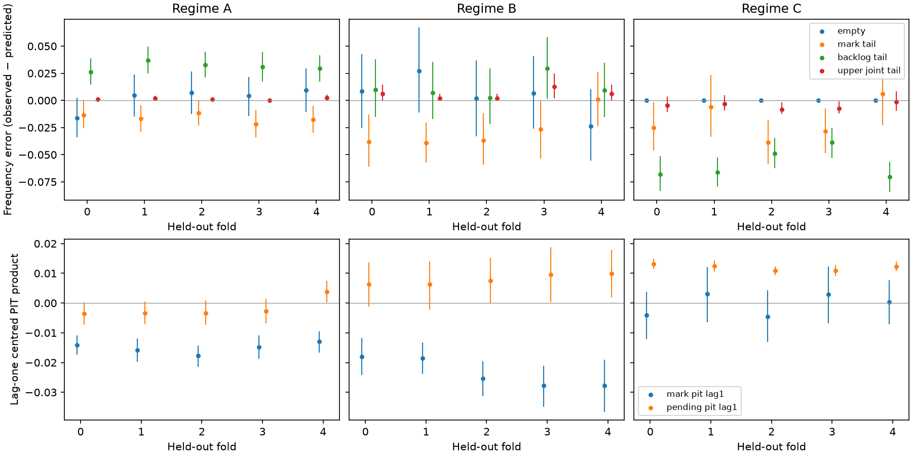

# Does the fitted outbox likelihood describe held-out intervals?

**The observation likelihood did not pass development validation.** The count and timing errors below persist when the evaluator supplies the true interval regime and both unfinished-work boundaries for this diagnostic. Increasing the particle count alone cannot remove those errors. This check does not measure the forecasting pipeline's gain over temporal history.

## Population and fit

The archived run used clean commit `147627d56195a887b336bed6edb7a7781f645f2c`. All 1,200 ordinary development roots contributed 12 intervals each. Each of the five recorded stratified folds held out 240 complete roots and fitted the likelihood on the other 960. For each interval, the fitted law used only the starting public history and the replayed development states. The ending reading was withheld until scoring. All 14,400 observations had finite joint log mass. Zero-mark intervals were absent, so the probability assigned to that tail remains extrapolative.

Forecast counts were integrated over all feasible mark counts. Tail thresholds were the training-fold 90th percentiles for the interval's generating regime. Each frequency estimate was compared with the observed event fraction. An error exceeding five percentage points triggered investigation when its whole-root 95% bootstrap interval excluded zero in the same direction in at least two folds of a regime. Within-root lag-one products of centred randomised count residuals used the approved same-direction interval rule. The attached figure shows the held-out errors and intervals. The receipt lists all 17 repeated discrepancies (five in A, nine in B and three in C). The accompanying five fold reports give the training digests, observations and root counts, predicted and observed frequencies, and achieved intervals.

## FIFO support correction

An early development check assigned positive probability to median completed delays above five seconds when slow-publisher histories had oldest pending age between two and five seconds. The public information is sufficient to rule out that delay for **394 of the 395** such observations. Only the first publication mark in an interval can inherit an earlier acknowledgement. If the interval contains M marks, mark i in completion order must finish by five seconds minus the time required for M − i subsequent claim–acknowledgement–mark cycles. A known starting pending count limits how many of those rows could have committed before the interval. An older row could have been pending for at most the prior oldest age. A newly committed row begins within the interval.

These facts bound the completion and commit ticks of each marked row. The first marked row has the exact previously observed oldest commit when the starting count is fresh and positive. Every inherited commit is at or before the interval start, every new commit is strictly later, and each intervening write consumes its fixed 1 ms insert. Taking the median of the individual lower and upper bounds, including both central ranks for an even count, bounds the observed median without requiring the delays to be sorted. The corrected likelihood excludes infeasible timing bands before renormalising. One of the 395 intervals retained a feasible portion of the (5, 10] second band. None of the 395 observed medians fell there. This correction addresses physical support. A band that overlaps the feasible range only slightly can still receive substantial probability under the ordinal model.

## Remaining discrepancies

| Development check | Observed result | Interpretation |
|---|---|---|
| Slow publisher, upper pending-count tail | In folds 0, 1 and 4 the observed fraction was 8.3–9.0%, against a predicted 15.0–16.0%. Each fold contained 480 intervals from 80 roots in regime C. | The fitted law gives too much probability to high backlog in these folds. Across all 400 slow-publisher roots, in the penultimate interval the observed fraction was 0.75% and the prediction averaged 26.0%. In the final interval they were 59.75% and 51.0%. Aggregate results conceal the change in error direction. These timing strata are evaluator diagnostics only. |
| Conditional completed delay | With oldest age in (2, 5] seconds under C, 65.4% of medians fell in (0.5, 2] seconds in folds 1 and 3. The law predicted approximately 53% in both. | This discrepancy survives the FIFO support correction in a physically feasible band. The data establish miscalibration of this conditional law. They do not uniquely attribute it to the ordinal link, the shared slopes or the omitted publisher memory. Several B timing cells also triggered. |
| Serial dependence | The mark residual lag-one product was negative in every A and B fold. The pending-count residual product was positive in every C fold. | Successive readings retain dependence after conditioning on the physical boundary regime, work and permitted starting context. Repeated updates can therefore convey more or less evidence than their fitted likelihoods imply. |
| Sparse timing-band smoothing | Removing the 0.001 uniform mixture from the fitted predictions left all held-out readings with finite mass. The change in mean joint log mass was below 0.001 per interval in each fold. | Sparse-band smoothing preserves support. Its effect on this population is too small to explain the persistent discrepancies. Rare conditional cells remain uncertain. |

Retain these results as a failed calibration gate. The narrow follow-up is to examine the conditional pending-excess distribution in slow-publisher histories and the age-conditioned delay residuals in their affected strata. The evaluator-only phase challenge can distinguish some omitted-memory effects from residual emission error. A change to the fitted law requires renewed root-disjoint development validation before method lock. The protected evaluation remains gated.

## Reproduction

Run `python -m particle_filter.validation.teacher_validation OUTPUT --workers 4` in the pinned study environment with a fresh output directory. The runner writes the full fold tables, interval predictions and tail/residual figure. The [development receipt](teacher/summary.json) records the outcomes needed to check this account. Fold bootstrap intervals use 2,000 whole-root resamples. The protected-evaluation resampling protocol is separate.
