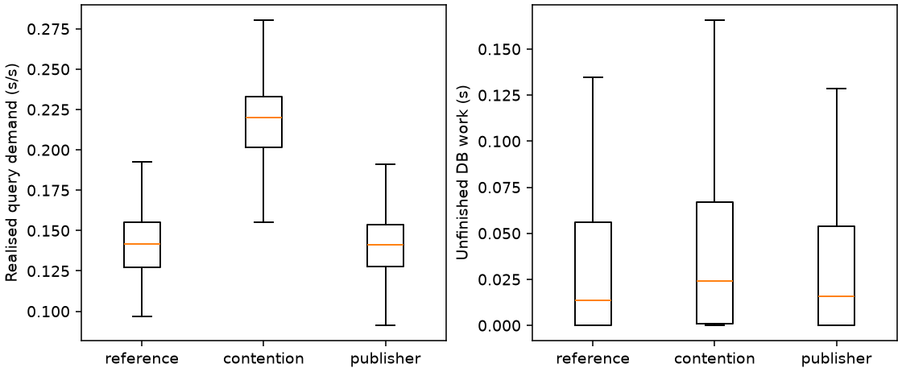
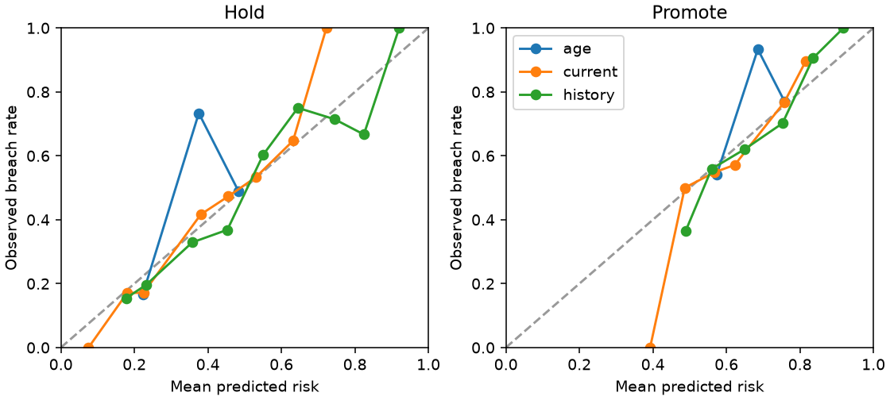
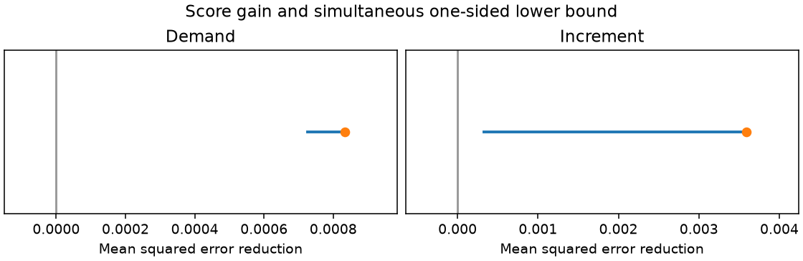

# AIMS5701 · Experimental Readiness Report

**Verdict — READY.**

## 1. Can the simulator supply legitimate pre-decision telemetry?

Yes, under the passive lifecycle-feed assumption. Each prefix produced twelve five-second aggregates. Rows appeared on commit and remained pending through acknowledgement until their mark completed. Delivery at interval end was idealised for this study. Boundary tests exercised delayed and missing delivery, no completed marks and empty outboxes. The audit independently reconstructed the histories on all 1,200 protected roots.

## 2. Can it compare both actions fairly?

Yes. Hold and promote inherited the same 25% prefix and the same future primitive draws. The independent replay checked applied admissions, cut state, endpoint counts and 800 additional surprise continuations. There was one primary paired future per root. Each pair samples a possible outcome conditional on its prefix.

| Protected population | Neither | Promote only | Hold only | Both | Hold risk | Promote risk | Increment |
|---|---:|---:|---:|---:|---:|---:|---:|
| all | 365 | 370 | 0 | 465 | 38.8% | 69.6% | +30.8% |
| reference | 181 | 155 | 0 | 64 | 16.0% | 54.8% | +38.8% |
| contention | 0 | 65 | 0 | 335 | 83.8% | 100.0% | +16.2% |
| publisher | 184 | 150 | 0 | 66 | 16.5% | 54.0% | +37.5% |
| surprise | 2 | 55 | 0 | 343 | 85.8% | 99.5% | +13.8% |

## 3. Do outbox observations predict contention and future promotion harm?

| Confirmatory claim | Development-selected level | Roots | Gain over prior | Gain over best constant | SE | Simultaneous lower bound | Supported |
|---|---|---:|---:|---:|---:|---:|---|
| demand | history | 800 | +0.000984 | +0.000834 | 0.000056 | +0.000725 | yes |
| increment | history | 1200 | +0.003636 | +0.003591 | 0.001666 | +0.000326 | yes |

The physical claim compares realised query demand among nominal publishers under reference and elevated query rates. The incremental-risk claim uses all three conditions. Each gain is a reduction in squared error, with one-sided Bonferroni bounds giving approximate 95% familywise coverage conditional on the development lock. The signed outcome includes hold-only breaches with weight −1.

| Diagnostic | Hold Brier | Promote Brier | Increment MSE | Demand RMSE (s/s) | Unfinished work RMSE (s) |
|---|---:|---:|---:|---:|---:|
| prior | 0.2374 | 0.2116 | 0.2133 | 0.0424 | 0.0676 |
| age | 0.2180 | 0.2015 | 0.2119 | 0.0392 | 0.0677 |
| current | 0.2122 | 0.1993 | 0.2111 | 0.0378 | 0.0647 |
| history | 0.1963 | 0.1935 | 0.2097 | 0.0308 | 0.0644 |
| evaluator | 0.1388 | 0.1671 | 0.2033 | — | — |

| Within-condition gain over its own mean | Demand | Signed increment |
|---|---:|---:|
| reference | -0.00080 [-0.00093, -0.00067] | -0.00781 [-0.01876, -0.00087] |
| contention | -0.00055 [-0.00069, -0.00041] | -0.01314 [-0.02049, -0.00699] |
| publisher | -0.00018 [-0.00021, -0.00014] | -0.00026 [-0.00395, +0.00023] |

Within-condition demand gains were zero or negative in reference and contention. Their mean was -0.00067. Between-condition differences contributed +0.00151 to the pooled gain of +0.00083.

Within-condition increment gains were zero or negative in reference and contention and publisher. Their mean was -0.00707. Between-condition differences contributed +0.01066 to the pooled gain of +0.00359.

These descriptive intervals compare each selected forecast to a constant that already knows the condition. Between-condition differences can therefore support a pooled claim even if prediction within each individual condition remains weak.

The temporal classifier identified 400/400 publisher-slowdown roots and 304/400 established-contention roots. It labelled 0 contention roots as publisher slowdown and 0 publisher roots as contention. Classification answers a separate question from estimating realised query work.

reference–contention histogram overlap was 81.5% for oldest age and 83.5% for count (100% means identical bin frequencies).

reference–publisher histogram overlap was 0.0% for oldest age and 0.0% for count (100% means identical bin frequencies).

contention–publisher histogram overlap was 0.0% for oldest age and 0.0% for count (100% means identical bin frequencies).

Relative to the prior, current measurements changed hold and promote Brier scores by gains of +0.02514 [+0.01892, +0.03116] and +0.01233 [+0.00747, +0.01714]. The signed-increment MSE gain was +0.00217 [-0.00016, +0.00449]. Positive gains favour current measurements. Action-specific forecasts can improve together while their difference gains little accuracy.

With private condition and physical targets, the evaluator reduced promotion Brier loss by +0.04458 versus the prior and +0.02640 versus history. Its increment MSE gains were +0.00996 and +0.00633, respectively. These differences measure the skill of the fitted evaluator with its extra inputs.

## 4. Does observation history improve on the current complete outbox?

| Target | History gain over current [descriptive 95% interval] |
|---|---:|
| hold | +0.01591 [+0.01079, +0.02091] |
| promote | +0.00585 [+0.00354, +0.00821] |
| increment | +0.00146 [-0.00076, +0.00362] |
| demand | +0.00049 [+0.00041, +0.00056] |
| unfinished | +0.00003 [-0.00001, +0.00008] |
| condition | +0.08762 [+0.07463, +0.10051] |

Intervals resample whole roots within condition with fixed fits. An interval crossing zero leaves improvement unresolved. The comparison with a complete current reading controls for the number of available sensor types.

The incremental-risk comparison leaves the added value of history unresolved.
## 5. Is simulator v1 ready to freeze?

Both protected information claims passed and the validity checks reconciled. The simulator is suitable for a subsequent synthetic forecasting experiment under this workload law. A later particle filter must earn any advantage over the complete current-value and simple temporal baselines on fresh protected histories.

Across ordinary condition/action pairs, breach rates ranged from 16.0% to 100.0%. Rates near the floor or ceiling leave little event variation. One future per prefix and 400 roots per condition limit power to resolve small differences.

Under the surprise increase, the frozen reference forecasts had promotion Brier loss change -0.22843 [-0.25305, -0.20307] for current measurements and increment MSE change -0.10852 [-0.13716, -0.07969]. The corresponding paired promotion breach-rate change was +0.44750 [+0.39750, +0.49500]. Positive score changes here mean greater loss under the shock.

The three conditions have equal design weights and fixed 30-second exposures. An unexpected future query increase received identical pre-decision forecasts to its ordinary reference sibling. Its outcomes appear separately above. The scores do not estimate deployment cost, production prevalence or a production gate threshold.

The [machine-readable results](scores.json) contain per-condition comparisons, calibration counts, classifier confusions, overlap and surprise comparisons. The [independent audit](independent-audit.json), [pilot reproduction](pilot-reproduction.json), [predictor lock](predictor-lock.json) and [run manifest](manifest.json) identify the retained evidence.
